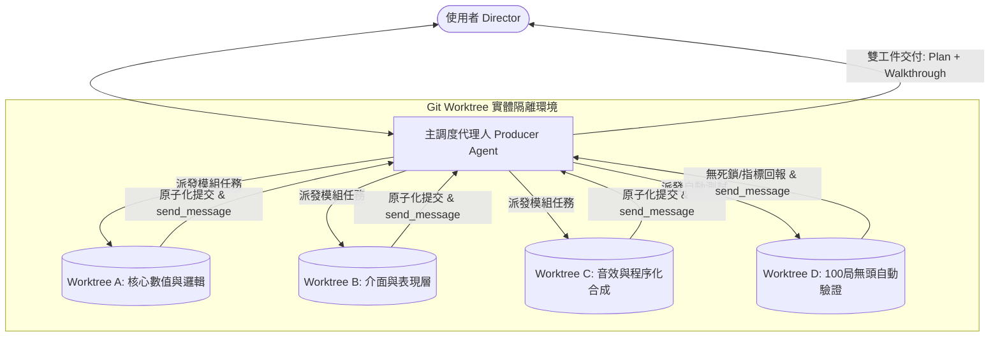

# 專案 AI 代理人蜂群協同與專業實踐手冊 (AGENTS.md)
**Project AI Agent Swarm Protocol & Professional Playbooks**

> **專案環境**：Windows (PowerShell) / Git Main  
> **核心使命**：提供高精準度、零冗餘、具自癒能力且完全隔離的多代理人協同作業框架。

---

## 一、 蜂群協同與工作樹架構 (Swarm & Git Worktree Protocol)

當面臨跨領域或大型系統專案時，嚴禁單一代理人混雜執行所有事務，必須嚴格落實「製作人—專家蜂群架構」：



### 1.1 製作人模式 (The Producer Pattern)
- **職責鎖定**：主調度代理人承擔「系統架構師與總製作人」職能：
  1. 拆解需求並擬定 `implementation_plan.md`。
  2. 使用 `swarm` / `define_subagent` 動態配置專業子代理人（Prompt 必須注入對應領域規範）。
  3. 控制任務依賴圖，監控子代理人回報。
  4. 整合並產出驗證工件 `walkthrough.md`。
- **上下文隔離**：主代理人嚴禁親自手寫龐大的具體實作程式碼，保持 Context 清晰，避免上下文污染。

### 1.2 Git Worktree 實體隔離機制
- **並行防撞守則**：調度 2 位以上子代理人平行編碼時，必須為各子代理人創建獨立工作樹：
  ```powershell
  # 建議使用專案專屬技能: worktree-manager
  powershell -ExecutionPolicy Bypass -File .agents/skills/worktree-manager/scripts/worktree.ps1 -Action add -Branch feat/ai-core -Path ../wt-ai-core
  ```
- **路徑限制**：子代理人只能在其被指定的 Worktree 範圍內執行 `run_command`、`edit_file` 或 `write_file`。
- **嚴禁衝突**：絕對禁止多個子代理人在同一時刻寫入相同的主工作樹目錄。

### 1.3 非同步等待與喚醒協定 (Asynchronous Reactivity)
- 當觸發耗時長程命令（如測試模擬、建置編譯、雲端長流程）時：
  - 子代理人必須利用 `schedule` 工具建立定時器或依賴系統任務回呼。
  - **嚴禁調用 `Start-Sleep` 或無效迴圈**。主動結束工具呼叫以交回控制權，等待系統反應式喚醒。
- 子代理人完成任務後，必須透過 `send_message` 向主代理人回報變更檔案、測試報告與關鍵指標。

---

## 二、 絕對禁止與反偷懶鐵律 (Anti-Shortcut Mandate)

> [!CAUTION]
> **以下行為列為專案最高紅線，觸犯即視為嚴重失敗：**

1. **嚴禁偽造模型（No Fake Model Substitution）**
   - 明確要求指定模型或特定外部管線時，嚴禁偷換為內建簡化替代品交差。
   - 缺少本機算力、顯存或 API Key 時，如實揭露現狀，給予使用者明確指引。

2. **嚴禁寫死動態分數（No Hardcoded Heuristic Camouflage）**
   - 決策模型嚴禁使用固定分數（如 `score = 3.5`）假裝完成評估。
   - 若推論逾時，必須實裝動態情勢感知降級評分機制。

3. **嚴禁擅自重繪實物公仔（No Generative Hallucination on Real Objects）**
   - 對於真實公仔、實體模型、真人照片去背任務，嚴格執行純背景消除（Alpha Matting / Segmentation），**嚴禁**使用生圖重繪破壞真實細節。

4. **依賴誠實回報（Full Transparency）**
   - 所有外部工具、環境版本依賴、CDN 狀態皆須百分之百誠實呈現，嚴禁虛假宣告通過測試。

---

## 三、 Windows 與終端環境防禦守則 (Windows Encoding Guard)

> [!IMPORTANT]
> 解決 Windows PowerShell 預設代碼頁 CP950 導致 `UnicodeEncodeError` 的黃金鐵律：

1. **指令前置 UTF-8 強制宣告**：
   ```powershell
   $env:PYTHONIOENCODING="utf-8"; chcp 65001 | Out-Null
   ```
2. **Python 腳本通用編碼頭部**：
   ```python
   import sys
   if hasattr(sys.stdout, 'reconfigure'):
       sys.stdout.reconfigure(encoding='utf-8')
   ```
3. **工作目錄絕對錨定**：
   - 每次調用 `run_command` 必須嚴格指定目標 `Cwd` 的絕對路徑。
   - 嚴禁透過 `cd` 切換目錄以防狀態遺失。

---

## 四、 工具精準調用黃金守則 (Precision Tooling Matrix)

針對歷史錯誤分析（字元匹配偏差佔 48%、讀取次數達 3.89:1 冗餘），全域落實三大規則：

| 工具 | 關鍵限制與黃金準則 | 違規痛點與防範措施 |
| :--- | :--- | :--- |
| **`edit_file`** | **微創手術原則（< 20 行）**<br>必須攜帶上下 2~3 行唯一識別代碼錨點。 | 避免大區塊縮排/換行符號偏差。若修改量超過 40% 或 80 行，**果斷轉向 `write_file` 整檔覆寫**。 |
| **`read_file`** | **精確範圍讀取（防禦性重讀消除）**<br>禁止重複讀取相同檔案片段；精算 EndLine 與 ContentOffset。 | 消除查看檔案次數是編輯次數 3.89 倍之冗餘，讀取前先檢查記憶，拒絕無意義反覆查看。 |
| **`write_file`** | **大改寫與初始化首選**<br>全新模組、規格工件或超過 40% 的大幅重構，直接覆寫保證一致性。 | 杜絕手動微調多處錨點失敗之循環重試。 |
| **`schedule`** | **非同步背景任務定時器**<br>搭配長時間運行背景命令，取代無效 sleep。 | 避免 Context 超時與主執行緒被無謂鎖死。 |

---

## 五、 驗證與交付閉環標準 (Verification & Dual-Artifact Standard)

任何重大任務必須嚴格落實雙工件與自動化測試閉環：

```text
[啟動任務] ──> 產出 implementation_plan.md ──> [使用者審查/確認]
                     │
                     ▼
          [蜂群子代理人 Git Worktree 隔離並行實作]
                     │
                     ▼
          [專案自動化測試 / scripts/verify.ps1]
                     │
                     ▼
[完成任務] ──> 產出 walkthrough.md (含可點擊連結與測試報告) ──> [正式交付]
```

1. **開工工件：`implementation_plan.md`**
   - 包含明確的架構方案、外部依賴檢查、風險防護、分工計畫與 User Review Required 項目。
2. **竣工工件：`walkthrough.md`**
   - 提供直觀的驗證說明、修改檔案清單、本機/預覽指令與點擊友善之本地檔案路徑 (`file:///...`)。
